## Hi there 👋

---

## Coding Activity Since 16 April 2026

<!--START_SECTION:waka-->

```txt
Python            97 hrs 27 mins        ███████▓░░░░░░░░░░░░░░░░░   30.13 %
Markdown          74 hrs 2 mins         █████▓░░░░░░░░░░░░░░░░░░░   22.89 %
TypeScript        33 hrs 12 mins        ██▓░░░░░░░░░░░░░░░░░░░░░░   10.27 %
Go                27 hrs 26 mins        ██░░░░░░░░░░░░░░░░░░░░░░░   08.48 %
Scala             21 hrs 11 mins        █▓░░░░░░░░░░░░░░░░░░░░░░░   06.55 %
Other             20 hrs 55 mins        █▓░░░░░░░░░░░░░░░░░░░░░░░   06.47 %
Bash              11 hrs 4 mins         █░░░░░░░░░░░░░░░░░░░░░░░░   03.42 %
Text              8 hrs 27 mins         ▓░░░░░░░░░░░░░░░░░░░░░░░░   02.61 %
JavaScript        5 hrs 43 mins         ▒░░░░░░░░░░░░░░░░░░░░░░░░   01.77 %
JSON              3 hrs 21 mins         ▒░░░░░░░░░░░░░░░░░░░░░░░░   01.04 %
```

<!--END_SECTION:waka-->

---

## Tech Stack

> Languages, frameworks, and tools that I work with.

### Frontend

<table>
  <tr>
    <td align="center" width="96">
      <a href="#tech-stack">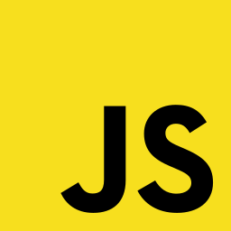</a>
      <br>JavaScript
    </td>
    <td align="center" width="96">
      <a href="#tech-stack"></a>
      <br>TypeScript
    </td>
    <td align="center" width="96">
      <a href="#tech-stack">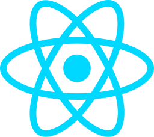</a>
      <br>React
    </td>
    <td align="center" width="96">
      <a href="#tech-stack">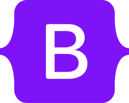</a>
      <br>Bootstrap
    </td>
    <td align="center" width="96">
      <a href="#tech-stack">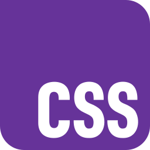</a>
      <br>CSS
    </td>
    <td align="center" width="96">
      <a href="#tech-stack">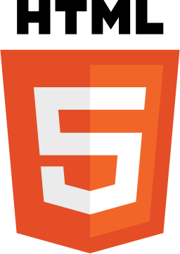</a>
      <br>HTML
    </td>
  </tr>
</table>

### Backend & Database

<table>
  <tr>
    <td align="center" width="96">
      <a href="#tech-stack">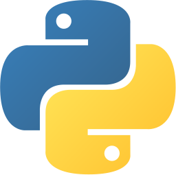</a>
      <br>Python
    </td>
    <td align="center" width="96">
      <a href="#tech-stack">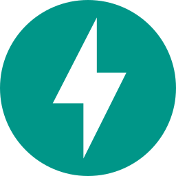</a>
      <br>FastAPI
    </td>
    <td align="center" width="96">
      <a href="#tech-stack"></a>
      <br>Django
    </td>
    <td align="center" width="96">
      <a href="#tech-stack">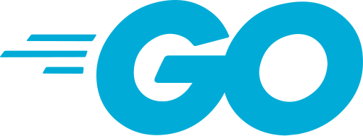</a>
      <br>Go
    </td>
    <td align="center" width="96">
      <a href="#tech-stack"><picture><source media="(prefers-color-scheme: dark)" srcset="./img/dark/flask.svg"></picture></a>
      <br>Flask
    </td>
  </tr>
  <tr>
    <td align="center" width="96">
      <a href="#tech-stack"><picture><source media="(prefers-color-scheme: dark)" srcset="./img/dark/sqlalchemy.svg"></picture></a>
      <br>SQLAlchemy
    </td>
    <td align="center" width="96">
      <a href="#tech-stack">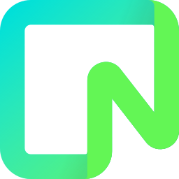</a>
      <br>Neon
    </td>
    <td align="center" width="96">
      <a href="#tech-stack"></a>
      <br>Supabase
    </td>
    <td align="center" width="96">
      <a href="#tech-stack">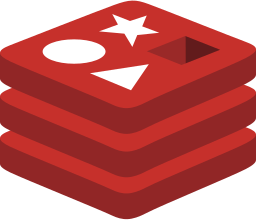</a>
      <br>Redis
    </td>
  </tr>
</table>

### Machine Learning

<table>
  <tr>
    <td align="center" width="96">
      <a href="#tech-stack"></a>
      <br>Scikit-learn
    </td>
    <td align="center" width="96">
      <a href="#tech-stack"><picture><source media="(prefers-color-scheme: dark)" srcset="./img/dark/pandas-icon.svg">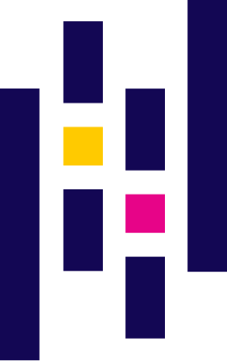</picture></a>
      <br>Pandas
    </td>
    <td align="center" width="96">
      <a href="#tech-stack">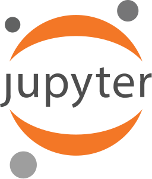</a>
      <br>Jupyter
    </td>
  </tr>
</table>

### Web Scraping & Automation

<table>
  <tr>
    <td align="center" width="96">
      <a href="#tech-stack">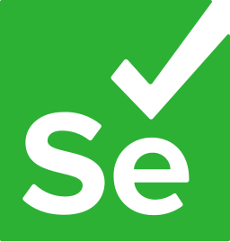</a>
      <br>Selenium
    </td>
    <td align="center" width="96">
      <a href="#tech-stack"></a>
      <br>Playwright
    </td>
    <td align="center" width="96">
      <a href="#tech-stack"></a>
      <br>Beautiful Soup
    </td>
  </tr>
</table>

### Others

<table>
  <tr>
    <td align="center" width="96">
      <a href="#tech-stack">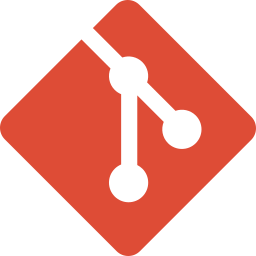</a>
      <br>Git
    </td>
    <td align="center" width="96">
      <a href="#tech-stack"><picture><source media="(prefers-color-scheme: dark)" srcset="./img/dark/github-icon.svg">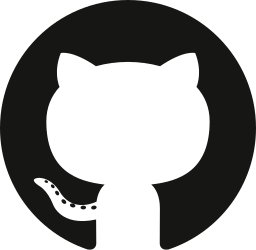</picture></a>
      <br>GitHub
    </td>
    <td align="center" width="96">
      <a href="#tech-stack"><picture><source media="(prefers-color-scheme: dark)" srcset="./img/dark/aws.svg"></picture></a>
      <br>AWS
    </td>
    <td align="center" width="96">
      <a href="#tech-stack">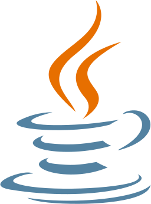</a>
      <br>Java
    </td>
    <td align="center" width="96">
      <a href="#tech-stack">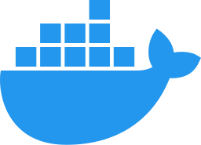</a>
      <br>Docker
    </td>
  </tr>
  <tr>
    <td align="center" width="96">
      <a href="#tech-stack"></a>
      <br>Linux
    </td>
    <td align="center" width="96">
      <a href="#tech-stack">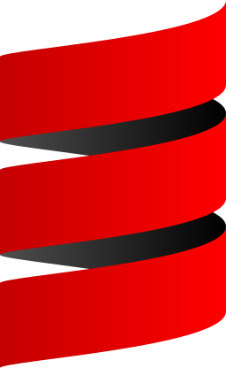</a>
      <br>Scala
    </td>
    <td align="center" width="96">
      <a href="#tech-stack">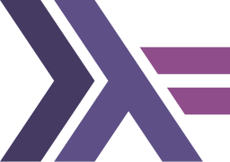</a>
      <br>Haskell
    </td>
    <td align="center" width="96">
      <a href="#tech-stack">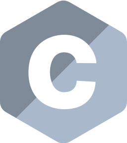</a>
      <br>C
    </td>
  </tr>
</table>

---

## 📊 Github Stats :

<p align="center">
  
</p>


<!--
**applejuice8/applejuice8** is a ✨ _special_ ✨ repository because its `README.md` (this file) appears on your GitHub profile.

Here are some ideas to get you started:

- 🔭 I’m currently working on ...
- 🌱 I’m currently learning ...
- 👯 I’m looking to collaborate on ...
- 🤔 I’m looking for help with ...
- 💬 Ask me about ...
- 📫 How to reach me: ...
- 😄 Pronouns: ...
- ⚡ Fun fact: ...
-->
