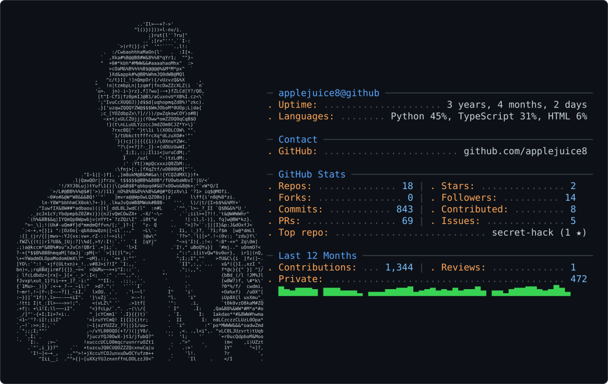
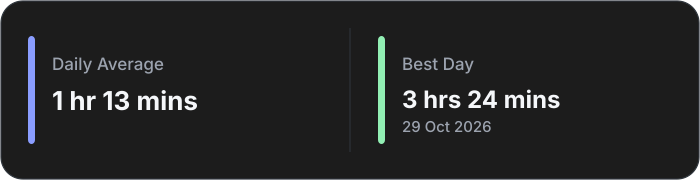
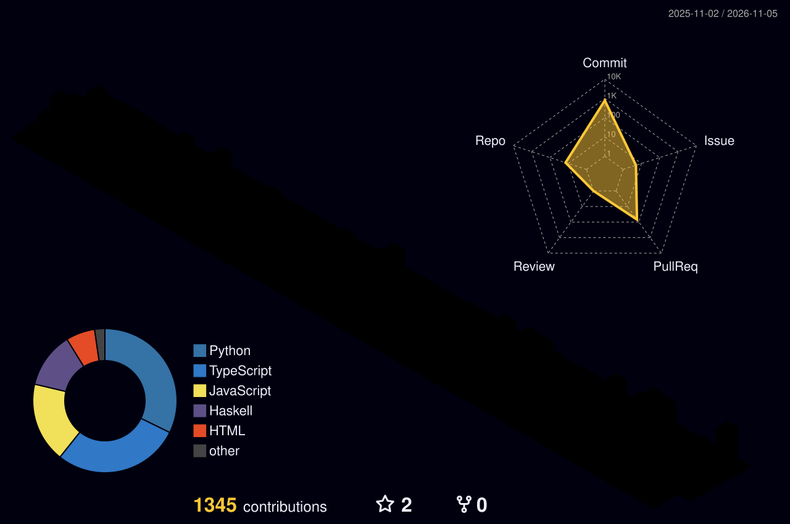

## Hi there 👋

<p align="center">
  
</p>

---

## Coding Activity Since 16 April 2026

<!--START_SECTION:waka-->

```txt
Python            97 hrs 27 mins        ███████▓░░░░░░░░░░░░░░░░░   30.13 %
Markdown          74 hrs 2 mins         █████▓░░░░░░░░░░░░░░░░░░░   22.89 %
TypeScript        33 hrs 12 mins        ██▓░░░░░░░░░░░░░░░░░░░░░░   10.27 %
Go                27 hrs 26 mins        ██░░░░░░░░░░░░░░░░░░░░░░░   08.48 %
Scala             21 hrs 11 mins        █▓░░░░░░░░░░░░░░░░░░░░░░░   06.55 %
Other             20 hrs 55 mins        █▓░░░░░░░░░░░░░░░░░░░░░░░   06.47 %
Bash              11 hrs 4 mins         █░░░░░░░░░░░░░░░░░░░░░░░░   03.42 %
Text              8 hrs 27 mins         ▓░░░░░░░░░░░░░░░░░░░░░░░░   02.61 %
JavaScript        5 hrs 43 mins         ▒░░░░░░░░░░░░░░░░░░░░░░░░   01.77 %
JSON              3 hrs 21 mins         ▒░░░░░░░░░░░░░░░░░░░░░░░░   01.04 %
```

<!--END_SECTION:waka-->

<!-- Generated daily by .github/workflows/wakadash.yaml (scripts/wakadash, MIT: github.com/Anant-mishra1729/WakaDash) -->
<p align="center">
  
</p>

---

## Tech Stack

### Frontend

<table>
  <tr>
    <td align="center" valign="middle" width="84">
      <a href="#tech-stack"></a>
      <br><sub>JavaScript</sub>
    </td>
    <td align="center" valign="middle" width="84">
      <a href="#tech-stack"></a>
      <br><sub>TypeScript</sub>
    </td>
    <td align="center" valign="middle" width="84">
      <a href="#tech-stack"></a>
      <br><sub>React</sub>
    </td>
    <td align="center" valign="middle" width="84">
      <a href="#tech-stack"></a>
      <br><sub>Bootstrap</sub>
    </td>
    <td align="center" valign="middle" width="84">
      <a href="#tech-stack"></a>
      <br><sub>CSS</sub>
    </td>
    <td align="center" valign="middle" width="84">
      <a href="#tech-stack"></a>
      <br><sub>HTML</sub>
    </td>
  </tr>
</table>

### Backend & Database

<table>
  <tr>
    <td align="center" valign="middle" width="84">
      <a href="#tech-stack"></a>
      <br><sub>Python</sub>
    </td>
    <td align="center" valign="middle" width="84">
      <a href="#tech-stack"></a>
      <br><sub>FastAPI</sub>
    </td>
    <td align="center" valign="middle" width="84">
      <a href="#tech-stack"></a>
      <br><sub>Django</sub>
    </td>
    <td align="center" valign="middle" width="84">
      <a href="#tech-stack"></a>
      <br><sub>Go</sub>
    </td>
    <td align="center" valign="middle" width="84">
      <a href="#tech-stack"></a>
      <br><sub>Flask</sub>
    </td>
  </tr>
  <tr>
    <td align="center" valign="middle" width="84">
      <a href="#tech-stack"></a>
      <br><sub>SQLAlchemy</sub>
    </td>
    <td align="center" valign="middle" width="84">
      <a href="#tech-stack"></a>
      <br><sub>Neon</sub>
    </td>
    <td align="center" valign="middle" width="84">
      <a href="#tech-stack"></a>
      <br><sub>Supabase</sub>
    </td>
    <td align="center" valign="middle" width="84">
      <a href="#tech-stack"></a>
      <br><sub>Redis</sub>
    </td>
  </tr>
</table>

### Machine Learning

<table>
  <tr>
    <td align="center" valign="middle" width="84">
      <a href="#tech-stack"></a>
      <br><sub>Scikit-learn</sub>
    </td>
    <td align="center" valign="middle" width="84">
      <a href="#tech-stack"></a>
      <br><sub>Pandas</sub>
    </td>
    <td align="center" valign="middle" width="84">
      <a href="#tech-stack"></a>
      <br><sub>Jupyter</sub>
    </td>
  </tr>
</table>

### Web Scraping & Automation

<table>
  <tr>
    <td align="center" valign="middle" width="84">
      <a href="#tech-stack"></a>
      <br><sub>Selenium</sub>
    </td>
    <td align="center" valign="middle" width="84">
      <a href="#tech-stack"></a>
      <br><sub>Playwright</sub>
    </td>
    <td align="center" valign="middle" width="84">
      <a href="#tech-stack"></a>
      <br><sub>Beautiful&nbsp;Soup</sub>
    </td>
  </tr>
</table>

### Others

<table>
  <tr>
    <td align="center" valign="middle" width="84">
      <a href="#tech-stack"></a>
      <br><sub>Git</sub>
    </td>
    <td align="center" valign="middle" width="84">
      <a href="#tech-stack"></a>
      <br><sub>GitHub</sub>
    </td>
    <td align="center" valign="middle" width="84">
      <a href="#tech-stack"></a>
      <br><sub>AWS</sub>
    </td>
    <td align="center" valign="middle" width="84">
      <a href="#tech-stack"></a>
      <br><sub>Java</sub>
    </td>
    <td align="center" valign="middle" width="84">
      <a href="#tech-stack"></a>
      <br><sub>Docker</sub>
    </td>
  </tr>
  <tr>
    <td align="center" valign="middle" width="84">
      <a href="#tech-stack"></a>
      <br><sub>Linux</sub>
    </td>
    <td align="center" valign="middle" width="84">
      <a href="#tech-stack"></a>
      <br><sub>Scala</sub>
    </td>
    <td align="center" valign="middle" width="84">
      <a href="#tech-stack"></a>
      <br><sub>Haskell</sub>
    </td>
    <td align="center" valign="middle" width="84">
      <a href="#tech-stack"></a>
      <br><sub>C</sub>
    </td>
  </tr>
</table>

---

## 🎮 Contribution Graphs

<!-- Generated daily by .github/workflows/profile-3d.yaml -->
<p align="center">
  
</p>

<!-- Isometric graph: generated daily by colincode0/github-readme -->
<p align="center">
  <picture>
    <source media="(prefers-color-scheme: dark)" srcset="https://raw.githubusercontent.com/colincode0/github-readme/main/output/contribs-dark.svg" />
    
  </picture>
</p>

---

## 🐉 Git Dragon

<!-- Generated daily by .github/workflows/dragon.yaml (git-dragon, MIT: github.com/echoo19/git-dragon) -->
<p align="center">
  
</p>

---

## 💻 Terminal


---

## 🖥️ ASCII Profile

<!-- Portrait: scripts/ascii/portrait.py from assets/source/profile.jpeg (static, regenerate by hand). Heatmap: refreshed daily by .github/workflows/ascii-heatmap.yaml -->
<p align="center">
  
</p>

<p align="center">
  
</p>

---

## 📈 Profile Cards

<!-- Generated daily by .github/workflows/profile-cards.yaml (seijikohara/profile-cards-action, MIT) -->
<picture>
  <source media="(prefers-color-scheme: dark)" srcset="./assets/profile-cards/overview.dark.svg" />
  
</picture>

<picture>
  <source media="(prefers-color-scheme: dark)" srcset="./assets/profile-cards/contributions.dark.svg" />
  
</picture>

---

## 📊 Github Stats :

<p align="center">
  
</p>


<p align="center">
  
</p>

[](https://leetcode.com/u/colinleonghongseng/)

<!--
**applejuice8/applejuice8** is a ✨ _special_ ✨ repository because its `README.md` (this file) appears on your GitHub profile.

Here are some ideas to get you started:

- 🔭 I’m currently working on ...
- 🌱 I’m currently learning ...
- 👯 I’m looking to collaborate on ...
- 🤔 I’m looking for help with ...
- 💬 Ask me about ...
- 📫 How to reach me: ...
- 😄 Pronouns: ...
- ⚡ Fun fact: ...
-->
